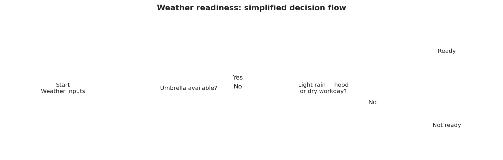
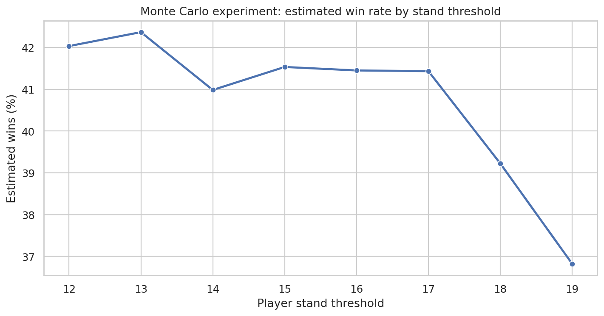
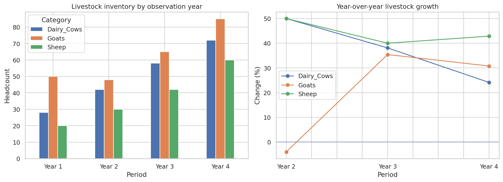
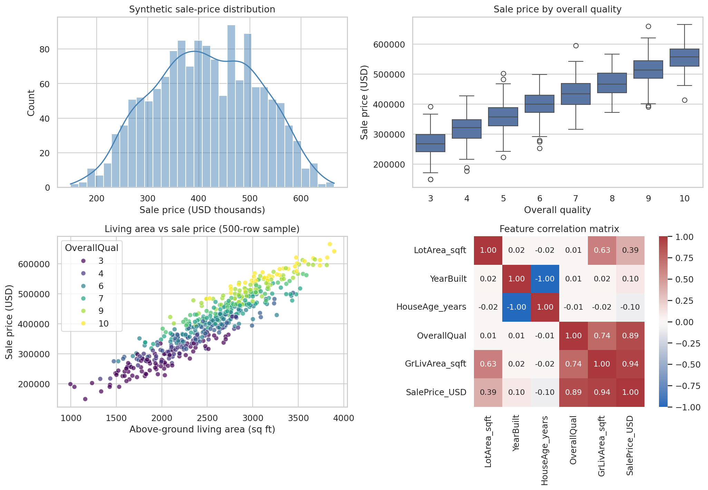

# Integrated Data Science Pipeline

**Author: HARPREET SINGH**

[](https://www.python.org/)
[](https://pandas.pydata.org/)
[]()
[](LICENSE)

An end-to-end, reproducible data-science portfolio project covering Python logic, a Monte Carlo experiment, pandas data engineering, synthetic dataset generation, exploratory data analysis (EDA), comparison tables, charts, and exportable artefacts.

> **Data notice:** all farm, livestock and housing records are illustrative/synthetic. The housing sample is inspired by common property attributes but is not the official Ames Housing dataset. Do not use the generated results as real market evidence.

## Project highlights

- Reusable Python functions with input validation.
- Weather decision matrix and a documented decision-flow diagram.
- Seeded Blackjack-inspired Monte Carlo simulation with a threshold comparison.
- pandas Series/DataFrames, percentage-change calculations and CSV exports.
- 1,460-row synthetic housing dataset with data-quality checks.
- Descriptive statistics, quality-group comparison, correlations and four-panel EDA dashboard.
- Notebook-generated CSV, PNG and report outputs.

## Visual results

### Decision logic


### Simulation


### Livestock comparison


### Housing EDA dashboard


## Repository structure

```text
data-science-foundations-to-eda/
├── README.md
├── LICENSE
├── .gitignore
├── requirements.txt
├── notebooks/
│   └── integrated_data_science_pipeline.ipynb
├── data/
│   ├── farm_produce.csv
│   ├── livestock_growth_record.csv
│   └── housing_profile_dataset.csv
├── figures/
│   ├── weather_decision_flow.png
│   ├── blackjack_simulation.png
│   ├── livestock_growth_comparison.png
│   └── housing_eda_dashboard.png
└── reports/
    ├── housing_summary_statistics.csv
    ├── housing_quality_comparison.csv
    └── blackjack_simulation_results.csv
```

## Quick start

### 1. Clone the repository

```bash
git clone https://github.com/<your-username>/data-science-foundations-to-eda.git
cd data-science-foundations-to-eda
```

### 2. Create and activate a virtual environment

```bash
python -m venv .venv
```

Windows:
```bash
.venv\Scripts\activate
```

macOS / Linux:
```bash
source .venv/bin/activate
```

### 3. Install dependencies

```bash
python -m pip install --upgrade pip
pip install -r requirements.txt
```

### 4. Run the notebook

```bash
jupyter lab
```

Open `notebooks/integrated_data_science_pipeline.ipynb` and choose **Run All**. The notebook writes generated datasets to `data/`, figures to `figures/`, and summary tables to `reports/`. Run it from the repository root so the relative project paths resolve as expected.

## Module comparison

| Module | Main techniques | Key outputs |
|---|---|---|
| Python logic | Functions, validation, boolean rules | Sign, allocation and weather decision tables |
| Simulation | Random sampling, Monte Carlo estimation | Threshold comparison table and line chart |
| Data engineering | pandas Series/DataFrames, aggregation, CSV I/O | Farm and livestock datasets; growth comparison |
| Housing EDA | Synthetic data, quality checks, descriptive stats, correlation | Housing CSV, summary tables and EDA dashboard |

## Data dictionary

### `farm_produce.csv`
Illustrative production quantities for apples, bananas and oranges across two actual-labelled periods and one forecast-labelled period. Values are examples only.

### `livestock_growth_record.csv`
Illustrative headcounts for dairy cows, goats and sheep across four observation periods.

### `housing_profile_dataset.csv`
| Column | Description |
|---|---|
| `LotArea_sqft` | Synthetic lot area in square feet |
| `YearBuilt` | Synthetic construction year |
| `HouseAge_years` | Age calculated relative to 2026 |
| `OverallQual` | Synthetic quality score from 3 to 10 |
| `GrLivArea_sqft` | Synthetic above-ground living area |
| `SalePrice_USD` | Synthetic sale price in US dollars |

## Interpretation and limitations

- The Blackjack-inspired simulator is deliberately simplified. It excludes casino shoe mechanics, betting, splits, doubles, insurance and several rule variations; its estimated win rates are not a recommendation or a casino-grade probability model.
- Synthetic housing relationships are encoded by the generator. Correlation is not causation, and the observed associations should not be generalized to real properties.
- The weather rule is an educational boolean-logic example, not a real-world safety assessment.
- Re-running with a different seed or generator assumptions may change the generated data and results.

## Potential extensions

1. Add `pytest` unit tests and CI checks for notebook execution.
2. Replace illustrative data with a documented, licensed real dataset.
3. Add baseline regression models and train/test evaluation.
4. Add a formal data dictionary and environment lock file.
5. Add model explainability and experiment tracking.

## Author

**HARPREET SINGH**

If you find this project useful, feel free to star the repository and share feedback.
